<div align="center">

# MIRAGE

**Multimodal Impersonation & Request-Aware Guard Engine**

*Seeing is no longer believing.*

Team Outliers · DJSCE · D3COY 1.0 · DJS ISACA · **Problem Statement 02: AI-Based Deepfake-Enabled Social Engineering Detection**

[](https://github.com/SDP42/isacaps2/actions/workflows/ci.yml)


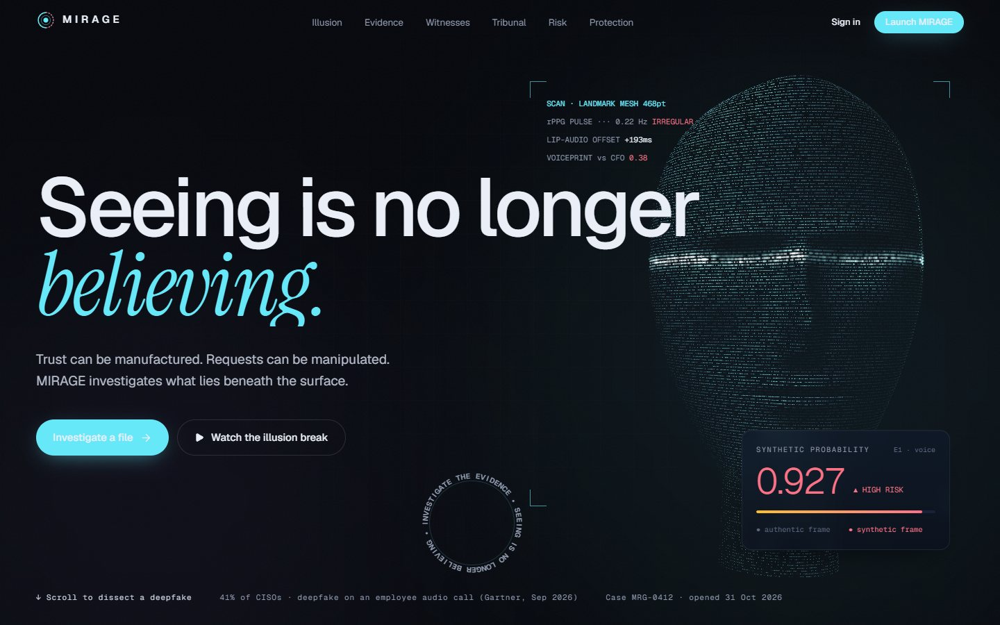

</div>

MIRAGE investigates a suspicious voice note, call, video meeting, screenshot, email or chat, and answers the question
that actually protects people: **is it safe to act on this request, and what do I do now?**

Most deepfake tools stop at "is this media fake?". That is not enough. A real voice can carry a fraudulent request, and
a harmless AI avatar should not trigger an alarm. MIRAGE treats the media detectors as witnesses, reads the request
and its context, explains every conclusion with numbered evidence, and then runs the **cure**: it holds the money,
proves who is really asking, drafts the police and bank paperwork, warns the people who are next, and turns the attack
into a drill so it fails next time.

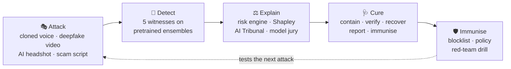

## Contents

1. [Highlights](#highlights)
2. [Screens](#screens)
3. [How it meets PS-02](#how-it-meets-ps-02)
4. [System architecture](#system-architecture)
5. [How a case is decided](#how-a-case-is-decided)
6. [Detection stack and results](#detection-stack-and-results)
7. [The cure](#the-cure)
8. [Red-team lab](#red-team-lab)
9. [Voice check and live call shield](#voice-check-and-live-call-shield)
10. [MIRAGE Shield (Chrome extension)](#mirage-shield-chrome-extension)
11. [Quick start](#quick-start)
12. [Five-minute demo](#five-minute-demo)
13. [API at a glance](#api-at-a-glance)
14. [Repository layout](#repository-layout)
15. [Testing and CI](#testing-and-ci)
16. [Security, privacy and responsible use](#security-privacy-and-responsible-use)
17. [Limitations and roadmap](#limitations-and-roadmap)
18. [Documentation](#documentation)
19. [Acknowledgements](#acknowledgements)

## Highlights

| | |
|---|---|
| **Request-aware, not just "is it fake"** | Five witnesses (voice, face, provenance, words, identity) feed a risk engine whose policy rules mean an uncertain detector can never talk a money or OTP request down. |
| **Published detectors, measured by us** | DF_Arena 500M and NII AntiDeepfake for voice (In-the-Wild EER 1.87% / 2.9%), Community Forensics and SwinV2 for AI images, GenD (WACV 2026) for face swaps, multilingual NLI and a phishing model for text. Ensembled in logit space after recentring each model on its measured threshold. |
| **Explainable to a non-expert** | Every claim cites exhibits (E1, E2…) tied to waveform seconds, words, frames and OCR boxes; a model jury shows each detector's vote; a waterfall shows how the score was built; an AI Tribunal argues both sides. |
| **The cure, not a checklist** | A live response run per scam type: exposure meter, golden-hour clock, challenge questions, pre-filled cybercrime.gov.in / 1930 / bank / Chakshu / CERT-In drafts, evidence-pack ZIP, scam-network blocklist, "who else was targeted", red-team drill. |
| **Thinks like the attacker** | The red-team lab forges labelled scams (neural voices, SD-Turbo portraits, avatar video) and launders them through phone, WhatsApp, MP3, reverb, noise and screenshots: 40/42 voice and 15/15 image variants caught. |
| **Where scams arrive** | Voice check, live call shield, and the MIRAGE Shield Chrome extension (right-click checks, tab-call shield, Gmail banners). |
| **Built for India** | English, Hindi and Hinglish; UPI / IFSC / Indian amount extraction; 1930, cybercrime.gov.in, Sanchar Saathi, CERT-In. |

## Screens

<table>
<tr>
<td width="50%">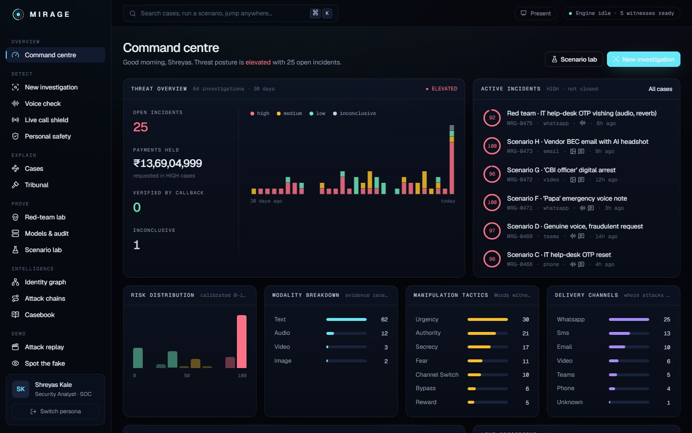<br><sub><b>Command centre</b>: live threat posture, incidents and tactics.</sub></td>
<td width="50%">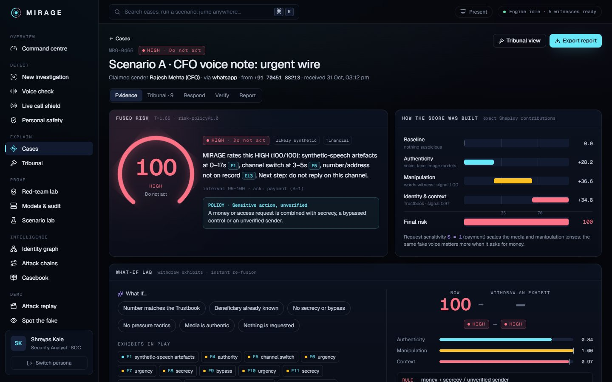<br><sub><b>Case evidence</b>: fused risk, how the score was built, what-if lab.</sub></td>
</tr>
<tr>
<td>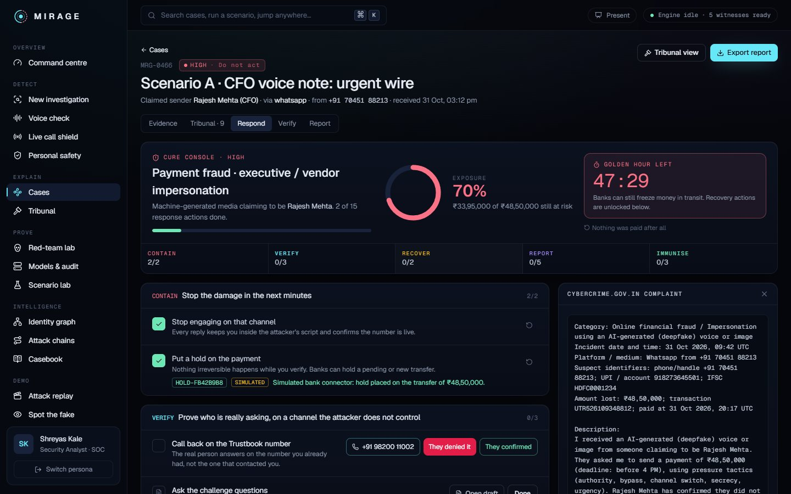<br><sub><b>Cure Console</b>: exposure meter, golden-hour clock, simulated bank hold, pre-filled complaint.</sub></td>
<td>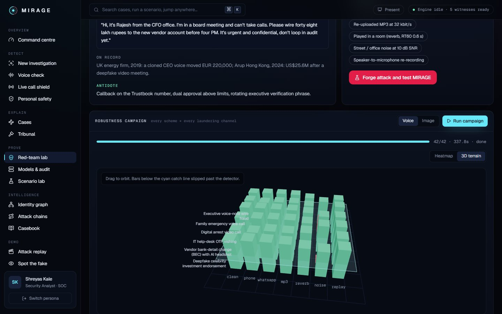<br><sub><b>Red-team lab</b>: robustness terrain; bars under the cyan plane slipped through.</sub></td>
</tr>
<tr>
<td>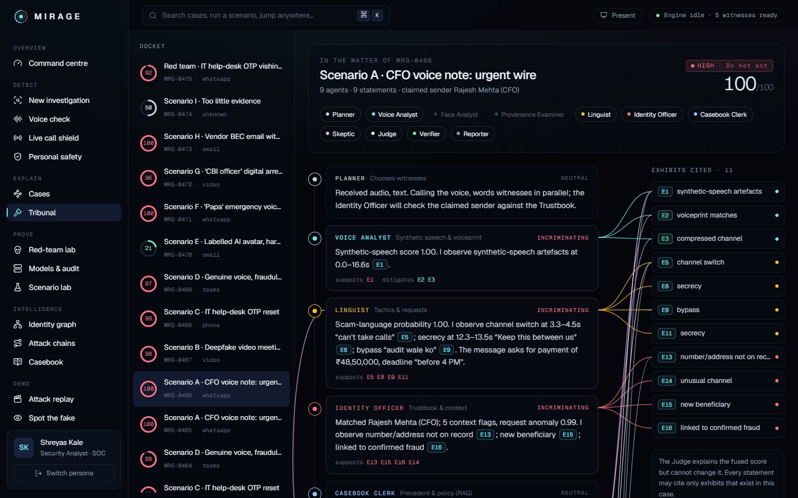<br><sub><b>AI Tribunal</b>: agents argue the case, every statement cites evidence.</sub></td>
<td>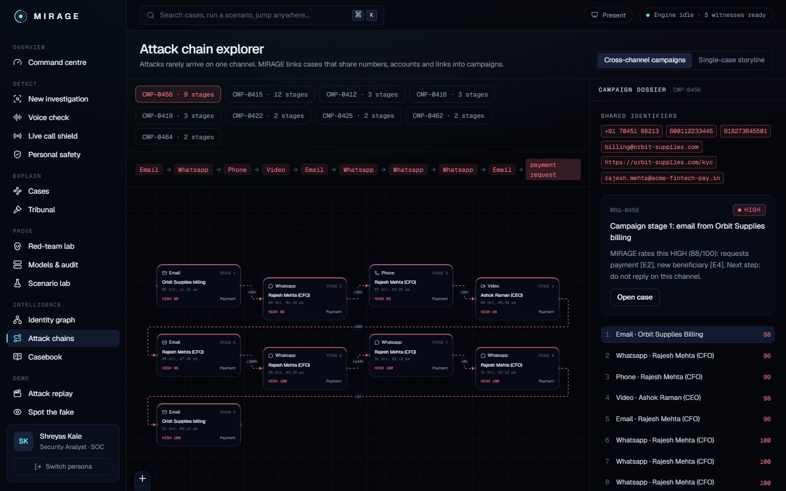<br><sub><b>Attack chains</b>: one campaign across email, WhatsApp, phone and video.</sub></td>
</tr>
</table>

<details>
<summary><b>Voice check, full page</b> (AI or human → what it asks → combined verdict → what now)</summary>
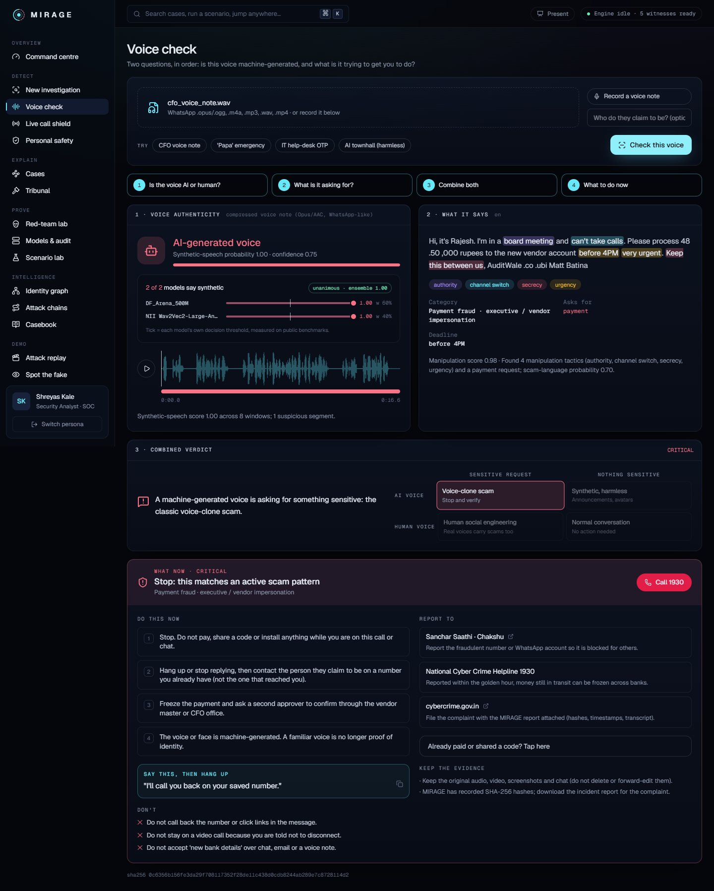
</details>

<details>
<summary><b>Models &amp; audit</b> and <b>red-team lab</b></summary>
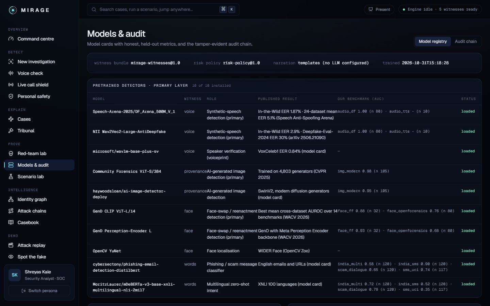
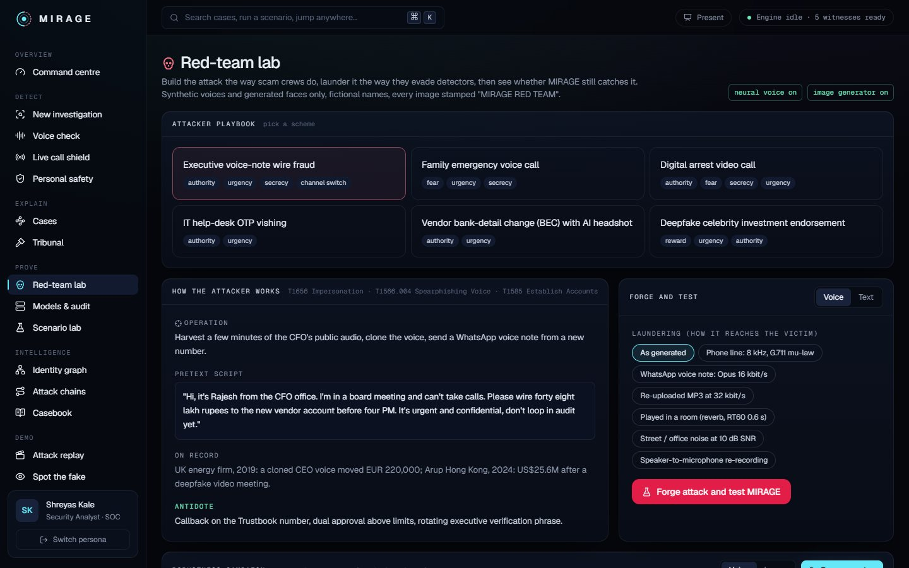
</details>

## How it meets PS-02

| PS-02 objective | How MIRAGE meets it |
|---|---|
| Synthetic media detection | **Voice**: DF_Arena 500M ⊕ NII AntiDeepfake per 4-second window, WavLM voiceprints, codec profile. **Face**: YuNet tracking, GenD CLIP ⊕ PE per face, lip-sync drift, AI-frame check for generated video. **Provenance**: Community Forensics ⊕ SwinV2, ELA, EXIF, generator metadata, C2PA presence. |
| Suspicious message analysis | **Words**: TF-IDF ⊕ phishing DistilBERT ⊕ multilingual zero-shot intent (⊕ optional Claude judge); tactic spans (authority, urgency, secrecy, fear, reward, channel switch, bypass); requested action; amount (Indian units), UPI, IFSC, account, URL, phone, deadline; look-alike domains; `.eml` header forensics. |
| Multimodal risk assessment | Policy rules first, then calibrated noisy-OR fusion of authenticity × sensitivity, manipulation × sensitivity and context, with an uncertainty interval and exact Shapley contributions. |
| Identity & context verification | The Trustbook (organisation + family), contact, channel and hours checks, approval limits, new / flagged beneficiaries, cross-case pattern memory, Isolation-Forest request anomaly. |
| Explainable detection | Cited exhibits, model jury, score waterfall, What-if lab, AI Tribunal with a Skeptic. |
| Alerting & response | "What now" on every result, the Cure Console, live call alerts, Chrome extension, hash-chained audit log, CERT-In-style PDF report, campaign linking. |

## System architecture

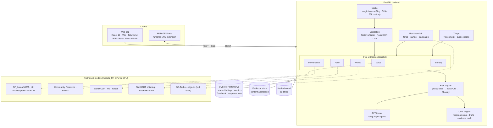

<details>
<summary><b>Data model</b></summary>

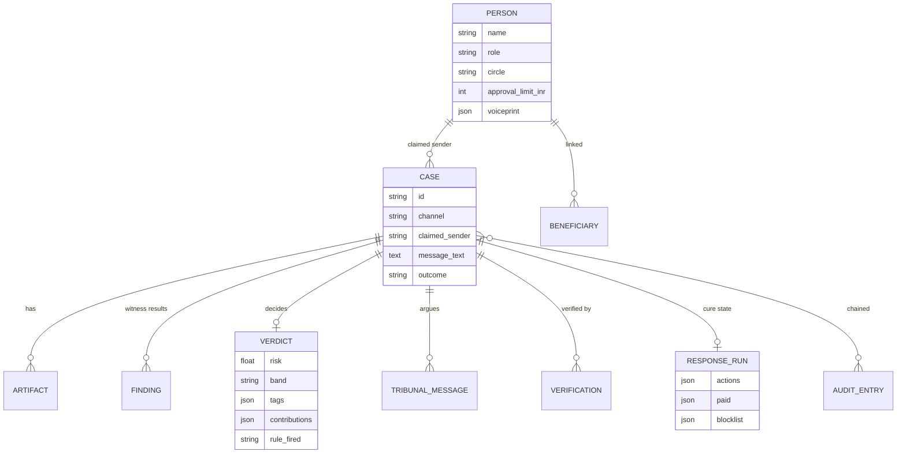
</details>

## How a case is decided

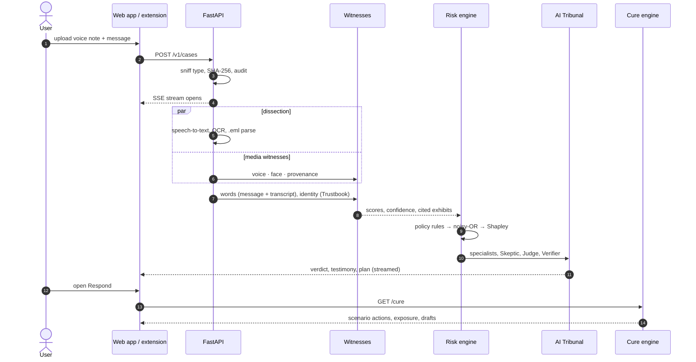

1. **Intake**: executables and archives are rejected; every file is SHA-256 hashed and audit-chained.
2. **Dissection**: faster-whisper transcribes with word timestamps (Hinglish kept in Roman script); RapidOCR reads screenshots; emails are parsed for SPF, DKIM, DMARC and Reply-To.
3. **Witnesses** run in parallel and return scores, confidence and exhibits.
4. **Risk engine**: hard policy rules, then `risk = 100·σ(logit(1 − (1 − A·S)(1 − M·S)(1 − C)) / T)` with T = 1.65, an uncertainty interval and exact Shapley values.
5. **Tribunal** (LangGraph): Voice, Face, Provenance, Linguist and Identity agents testify, the Casebook Clerk brings precedent, the Skeptic argues innocence, the Judge explains (and cannot change) the score, the Verifier builds the plan.
6. **Verdict**: LOW / MEDIUM / HIGH / INCONCLUSIVE, streamed live, persisted with model and policy versions.

## Detection stack and results

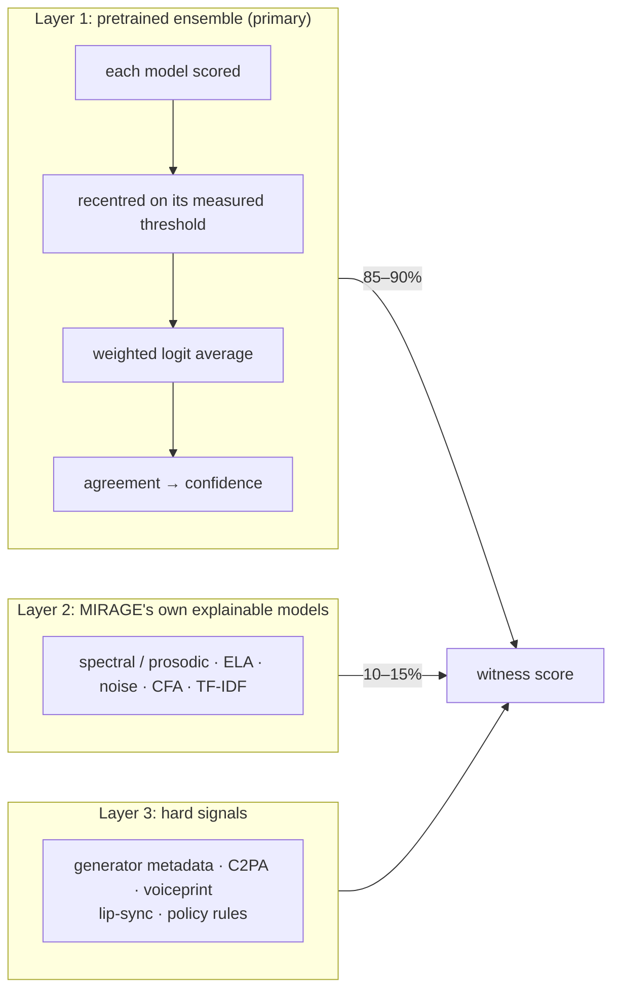

| Witness | Primary models | Our benchmark (public samples) |
|---|---|---|
| Voice | DF_Arena 500M ⊕ NII Wav2Vec2-Large AntiDeepfake, 4 s windows | AUC 1.00 on real vs deepfake speech; 10/10 Windows TTS caught |
| Image | Community Forensics ViT-S/384 ⊕ SwinV2 | AUC 0.98, 94% accuracy on Flux, DALL-E 3, SDXL, Midjourney vs real photos |
| Face | YuNet → GenD CLIP ⊕ GenD Perception Encoder | AUC 0.92 FaceForensics++ / Celeb-DF; 0.71 OpenForensics (weakest) |
| Text | TF-IDF ⊕ phishing DistilBERT ⊕ mDeBERTa zero-shot (⊕ Claude) | AUC 0.94 Indian SMS scams; 0.91 scam call transcripts |
| Voiceprint | WavLM-base-plus-sv x-vectors | VoxCeleb1 EER 0.84% (published) |

DF_Arena and GenD ship custom code; both are reviewed and vendored (`app/witnesses/df_arena.py`, `gend.py`), so nothing
runs with `trust_remote_code`. Full method, thresholds and per-model numbers: [docs/DETECTION.md](docs/DETECTION.md).

## The cure

Detection tells someone they are being attacked; the cure protects them. Every case has a **Respond** tab with a
live, stateful response run built for its scam type.

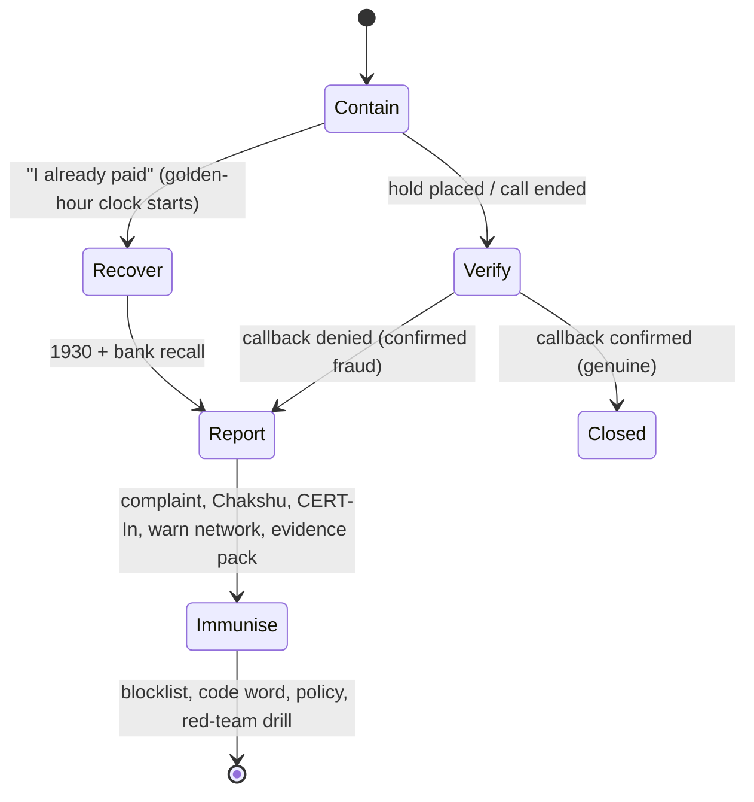

| Capability | What it does |
|---|---|
| **Exposure meter** | Money or access still at risk, falling as weighted actions complete (₹48.5 L → ₹33.9 L after a hold, for example) |
| **Golden-hour clock** | Starts when money moved; unlocks 1930 and bank recall; shows when same-day recovery is still possible |
| **Challenge questions** | Built from the Trustbook and case: code word, shared facts, callback on the saved number; the outcome closes the case |
| **Pre-filled paperwork** | cybercrime.gov.in complaint, 1930 call script, bank recall request, Sanchar Saathi (Chakshu) report, CERT-In summary, warning broadcast |
| **Evidence pack** | ZIP of originals, SHA-256 manifest, incident report PDF and every draft |
| **Scam-network kill** | Flags the UPI IDs, accounts and numbers; lists other cases that share them ("who else was targeted") |
| **Immunise** | Family code word, dual approval for new beneficiaries, and the same attack opened as a red-team drill |
| **Connectors** | Bank hold, identity reset and SOC ticket return clearly labelled `SIMULATED` references |

Scenario plans (payment fraud, credential theft, remote access, digital arrest, family emergency, reward lure, data
theft) and the design rationale: [docs/CURE.md](docs/CURE.md).

## Red-team lab

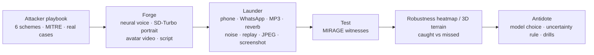

| Channel | Voice attacks caught | Image attacks caught |
|---|---|---|
| As generated · phone · WhatsApp · MP3 · reverb · replay | 36/36 | 3/3 |
| Street noise at 10 dB SNR | 4/6 | — |
| JPEG q40 · resize · screenshot · social pipeline | — | 12/12 |

Noise is the measured weak spot: it pushes fakes down and some real voices up, so below 19 dB SNR MIRAGE reports the
voice as **uncertain** instead of guessing, and the verdict rests on the request. Guardrails: synthetic voices and
generated faces only, every image stamped "MIRAGE RED TEAM", analyst role, audit-logged. See
[docs/RED_TEAM.md](docs/RED_TEAM.md) and the [attacker playbook](docs/ATTACKER_PLAYBOOK.md).

## Voice check and live call shield

| Step | Question | How |
|---|---|---|
| 1 | Is the voice AI-generated or human? | Voice ensemble per 4 s window, model jury, noise-aware uncertain band |
| 2 | What is it asking for? | Whisper transcript → tactics, request, amount, UPI, deadline, category |
| 3 | How bad is it? | 2×2 matrix: AI / human × sensitive / harmless (a harmless AI announcement stays LOW) |
| 4 | What now? | The response plan, with a link into the full cure for cases |

The **live call shield** runs the same checks every 3 seconds on a microphone or tab, draws a risk river and brings in
the plan at the first HIGH moment. Details: [docs/AFTER_DETECTION.md](docs/AFTER_DETECTION.md).

## MIRAGE Shield (Chrome extension)

Manifest V3, no build step (`extension/`): check a pasted message, upload a voice note or image, right-click any text,
image or voice note, **shield a call tab** (Meet, Zoom web, Teams, WhatsApp Web) with live risk in the badge and a
notification at HIGH, and opt into Gmail banners on risky emails. Load it from `chrome://extensions` → *Load unpacked*.
See [docs/EXTENSION.md](docs/EXTENSION.md).

## Quick start

Requirements: **Python 3.11+**, **Node 20+**, ~10 GB of disk for pretrained weights. NVIDIA GPU optional (install the
CUDA build of PyTorch first: `pip install torch torchvision --index-url https://download.pytorch.org/whl/cu128`).

```bash
# backend
cd backend
python -m venv .venv && source .venv/bin/activate      # Windows: .venv\Scripts\activate
pip install -r requirements.txt
python scripts/download_models.py                      # pretrained detectors (~7 GB)
python scripts/download_models.py redteam              # optional: SD-Turbo for the red-team lab
uvicorn app.main:app --port 8000
```

```bash
# frontend (second terminal)
cd frontend
npm install                     # if the npm registry is blocked: --registry=https://registry.yarnpkg.com
npm run dev                     # http://localhost:5173
```

Open http://localhost:5173 → **Launch MIRAGE** → pick a persona. Ready-made test files for every feature (voice notes,
calls, images, videos, messages, emails, multi-file cases, an extension test page) are in [demo_inputs/](demo_inputs/README.md).

 The first start seeds the Trustbook and runs ~50
historical cases. Docker: `docker compose up --build`. Environment variables and troubleshooting:
[docs/SETUP.md](docs/SETUP.md).

## Five-minute demo

Press **Present** in the header (or ⌘K → *Start the demo walkthrough*; Alt+←/→ to move):

| # | Step | Screen |
|---|---|---|
| 1 | Forge the attack the way scammers do | Red-team lab |
| 2 | Is the voice real? What does it want? | Voice check |
| 3 | Full investigation | Case → Evidence |
| 4 | Why, with evidence | Case → Tribunal |
| 5 | The cure: hold, verify, golden hour, paperwork | Case → Respond |
| 6 | Live on a call | Live call shield |
| 7 | Why trust it | Models & audit |

The script is in [docs/DEMO.md](docs/DEMO.md).

## API at a glance

| Area | Endpoints |
|---|---|
| Cases | `POST /v1/cases`, `GET /v1/cases/{id}`, `GET /v1/cases/{id}/events` (SSE), `/whatif`, `/report.pdf`, `/graph` |
| Cure | `GET /v1/cases/{id}/cure`, `POST …/cure/actions/{action}`, `POST …/cure/paid`, `GET …/cure/drafts`, `GET …/cure/evidence-pack` |
| Triage | `POST /v1/voice/triage`, `POST /v1/quick/text`, `POST /v1/quick/media`, `POST /v1/live/chunk` |
| Red team | `GET /v1/redteam/catalog`, `POST /v1/redteam/generate`, `POST /v1/redteam/campaign`, `GET /v1/redteam/campaigns/latest` |
| Platform | `/v1/auth/*`, `/v1/dashboard`, `/v1/models`, `/v1/audit`, `/v1/scenarios` |

Full reference: [docs/API.md](docs/API.md); interactive OpenAPI at http://localhost:8000/docs.

## Repository layout

```
.
├── backend/
│   ├── app/
│   │   ├── main.py                 FastAPI app, warm start (models, samples, history)
│   │   ├── pipeline.py             case lifecycle: dissection → witnesses → identity → fusion → Tribunal
│   │   ├── witnesses/              voice · face · provenance · words · identity · pretrained (ensembles)
│   │   │                           df_arena.py · gend.py (vendored, reviewed model code)
│   │   ├── fusion/                 risk.py (policy + noisy-OR + Shapley) · response.py (what now) · playbooks · whatif
│   │   ├── cure.py                 Cure Console: response runs, drafts, evidence pack, blocklist
│   │   ├── redteam.py              attack forge, laundering, campaigns
│   │   ├── agents/                 tribunal.py (LangGraph) · llm.py (narration, optional Claude judge)
│   │   ├── rag/                    hybrid casebook retrieval + corpus
│   │   └── routers/                auth · cases · triage · redteam · misc
│   ├── ml/                         MIRAGE's own model training (synthetic data)
│   ├── models_store/               own models, metrics.json, benchmark.json (committed)
│   ├── scripts/                    download_models · fetch_benchmark · benchmark_models · capture_screens
│   └── tests/                      26 tests: scenarios, rules, voice matrix, response plans, laundering, cure, ops, drills, C2PA
├── frontend/src/
│   ├── pages/app/                  Dashboard · Investigate · VoiceCheck · LiveShield · CaseView · RedTeam · …
│   ├── components/                 app/ (ModelJury, RiskRiver, WhatNow, Presenter) · case/ (CureConsole, RiskWaterfall)
│   │                               three/ (landing world, RobustnessTerrain) · ui/
│   └── lib/                        api client, hooks, recorder, formatting
├── extension/                      MIRAGE Shield (Chrome MV3)
├── docs/                           design docs and images (index below)
└── .github/workflows/ci.yml        backend tests, frontend typecheck + build, extension checks
```

## Testing and CI

```bash
cd backend && python -m pytest -q                                             # full suite with models (stop the API on ≤8 GB GPUs)
cd backend && MIRAGE_PRETRAINED=off MIRAGE_ASR=off MIRAGE_OCR=off python -m pytest -q   # what CI runs (~45 s)
cd frontend && npx tsc -b --noEmit && npx vite build
```

26 tests (light mode, as CI runs them) cover the Scenario Lab verdicts (with citation integrity and Tribunal order),
upload rejection, auth, text extraction, the credential and harmless-synthetic rules, Shapley additivity, audit-chain
tamper detection, the voice-check matrix, response plans, red-team laundering, the full Cure Console flow, the
command-centre overview and demo reset, Trustbook editing and consent rules, Drill mode, liveness pose directions and
C2PA validation (including a tampered image). GitHub Actions runs the
backend suite, the frontend typecheck and build, and extension syntax checks on every push and pull request.

## Security, privacy and responsible use

Demo authentication only; evidence is stored unencrypted; cure connectors are simulated. The red-team lab is
guardrailed (no real people, stamped, audited, analyst-only). Several models are non-commercial (NII AntiDeepfake
CC BY-NC-SA 4.0, SD-Turbo). See [SECURITY.md](SECURITY.md).

## Limitations and roadmap

- In-the-wild face swaps (AUC ~0.71) and fully generated video are the weakest media cases.
- Noisy audio is reported as uncertain rather than judged.
- Local text models trail an LLM; set `ANTHROPIC_API_KEY` for the Claude judge.
- The Chrome extension still needs an end-to-end run inside Chrome; authentication is demo personas.

Prioritised next steps: [ROADMAP.md](ROADMAP.md), [docs/PLAN.md](docs/PLAN.md), [docs/UI_PLAN.md](docs/UI_PLAN.md).
History: [CHANGELOG.md](CHANGELOG.md).

## Documentation

| Document | Contents |
|---|---|
| [docs/HANDOVER.md](docs/HANDOVER.md) | Start here to take over: constraints, workflow, architecture, file map, results, next steps |
| [demo_inputs/README.md](demo_inputs/README.md) | 32 test inputs across every feature, with expected and measured results |
| [docs/SYSTEM_OVERVIEW.md](docs/SYSTEM_OVERVIEW.md) | What is built, architecture, flow, features, use cases, results |
| [docs/CURE.md](docs/CURE.md) | The cure: ideas, scenario plans, architecture, what is simulated |
| [docs/DETECTION.md](docs/DETECTION.md) | Pretrained detection stack, calibration, benchmark |
| [docs/RED_TEAM.md](docs/RED_TEAM.md) | Red-team lab: guardrails, generators, laundering, findings |
| [docs/ATTACKER_PLAYBOOK.md](docs/ATTACKER_PLAYBOOK.md) | How deepfake scam crews operate and evade detectors |
| [docs/AFTER_DETECTION.md](docs/AFTER_DETECTION.md) | Two-stage voice check and the "what now" plan |
| [docs/EXTENSION.md](docs/EXTENSION.md) | MIRAGE Shield Chrome extension |
| [docs/HOW_IT_WORKS.md](docs/HOW_IT_WORKS.md) | Step-by-step walkthrough with a worked example |
| [docs/ARCHITECTURE.md](docs/ARCHITECTURE.md) | Components, data flow, schema, security |
| [docs/API.md](docs/API.md) | Every endpoint |
| [docs/MODEL_CARDS.md](docs/MODEL_CARDS.md) | MIRAGE's own models: methodology, data, metrics |
| [docs/FEATURES.md](docs/FEATURES.md) | Feature catalogue with status |
| [docs/FRONTEND.md](docs/FRONTEND.md) | Design system, screens, 3D world, motion |
| [docs/UI_PLAN.md](docs/UI_PLAN.md) | UI audit and phased roadmap with build status |
| [docs/PLAN.md](docs/PLAN.md) | Build plan: attack, detect, respond, deploy |
| [docs/SETUP.md](docs/SETUP.md) | Installation, environment variables, troubleshooting |
| [docs/DEMO.md](docs/DEMO.md) | Five-minute demo script |
| [docs/USE_CASES.md](docs/USE_CASES.md) | Personas, use cases, scenario behaviour |
| [docs/PROBLEM_STATEMENT.md](docs/PROBLEM_STATEMENT.md) | PS-02 restated and mapped |
| [docs/LIMITATIONS_AND_RESPONSE.md](docs/LIMITATIONS_AND_RESPONSE.md) | Limitations, ethics, response workflow |
| [CONTRIBUTING.md](CONTRIBUTING.md) · [SECURITY.md](SECURITY.md) · [CHANGELOG.md](CHANGELOG.md) | Project process |

## Acknowledgements

Speech-Arena-2025 (DF_Arena), NII Yamagishi Lab (AntiDeepfake), Microsoft (WavLM), Park & Owens (Community Forensics),
haywoodsloan (SwinV2 AI-image detector), Yermakov, Cech, Matas & Fritz (GenD), OpenCV Zoo (YuNet), cybersectony
(phishing DistilBERT), Moritz Laurer (mDeBERTa NLI), Stability AI (SD-Turbo), SYSTRAN (faster-whisper), RapidOCR, and
the public datasets used for benchmarking (listed in `backend/scripts/fetch_benchmark.py`). Model licences apply.
