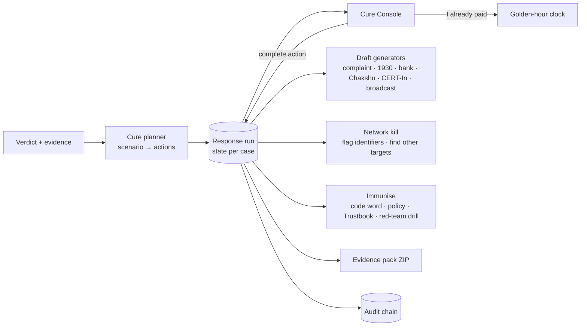

# The cure: from verdict to recovery

Detection tells someone they are being attacked. The cure is what actually protects them: stopping the money, proving
who is really on the line, recovering what moved, warning the people who are next, and making the same attack fail
next time. MIRAGE implements this as the **Cure Console**, a live incident-response run attached to every case.

## Why a console, not a card

A static checklist fails at the exact moment it matters: people under pressure skip steps, lose the transaction ID,
miss the hour in which banks can still freeze money, and never warn the colleague who gets the same call tomorrow.
The console makes the response **stateful, timed, pre-filled and measurable**.

## Ideas, and what made the cut

| Idea | What it does | Why it is unique / useful | Built |
|---|---|---|---|
| **Five-stage run** | Contain → Verify → Recover → Report → Immunise, with actions chosen for the scenario | Mirrors real incident response (NIST SP 800-61) but in plain language and per scam type | ✅ |
| **Exposure meter** | Money or access at risk, falling as actions are completed | Turns "did I do enough?" into a visible number; strong demo moment | ✅ |
| **Golden-hour clock** | Starts at the moment money moved; shows how much is still realistically recoverable | Recovery odds drop sharply after the first hour; the clock creates the right urgency | ✅ |
| **Challenge builder** | Verification questions specific to the claimed person and case (code word, shared facts, a callback on the Trustbook number) | A cloned voice cannot answer what only the real person knows | ✅ |
| **Paperwork, pre-filled** | cybercrime.gov.in complaint, 1930 call script, bank recall request, Sanchar Saathi report, CERT-In incident summary | Victims lose hours finding identifiers; MIRAGE already extracted them (UPI, account, IFSC, amount, numbers, times, hashes) | ✅ |
| **Evidence pack** | One ZIP: originals, SHA-256 manifest, incident report PDF, all drafts, audit-chain head | Chain of custody that police and banks accept without re-collecting | ✅ |
| **Scam-network kill** | Blocks the UPI IDs, accounts and numbers organisation-wide and finds **who else** received the same identifiers | One victim's report protects the next ones automatically | ✅ |
| **Warning broadcast** | A ready-to-send alert for the team or family group with the indicators and the safe rule | Attackers reuse scripts within hours | ✅ |
| **Immunise (attack vaccine)** | Sets the family code word, tightens payment approval, adds the verified number to the Trustbook, and opens the same attack in the red-team lab as a drill | Closes the loop: the attack that got through becomes the test everyone practises against | ✅ |
| Connectors (bank hold, telecom report, SOC ticket) | Calls out to bank / telecom / ticketing APIs | Real integration needs partner APIs; MIRAGE ships **clearly labelled simulated connectors** with the real interface shape | ✅ simulated |
| Auto-call 1930 / auto-file complaints | Fully automatic filing | Rejected: filing must be done by the victim; MIRAGE prepares everything and opens the right page | — |

## Scenario cures

| Scenario | Contain | Verify | Recover (if money or a code moved) | Report | Immunise |
|---|---|---|---|---|---|
| **Executive / vendor payment fraud** | Hold the payment; stop replying | Callback on the Trustbook number; executive verification question; second approver | 1930 within the golden hour; bank recall letter; complaint draft | SOC ticket; CERT-In summary; warn finance | Block beneficiary; dual approval above limit; drill the finance team |
| **Credential theft (OTP / password)** | Revoke sessions, reset password, block card | Call the bank or IT on the official number | Bank fraud line; dispute unauthorised debits | Complaint; Chakshu report of the number | Number-matching MFA; "IT never asks for codes" drill |
| **Remote-access scam** | Disconnect, uninstall the app, change passwords from another device | — | Bank fraud line; complaint | Chakshu; SOC | Block remote-access tools on work devices |
| **Digital arrest** | End the call; never transfer to "verify" | Call the local police station yourself | 1930; bank recall | Chakshu (number and WhatsApp account); complaint | Family awareness note; code word |
| **Family emergency** | Do not pay; stay off the new number | Code word; call the relative on the saved number | 1930; bank recall | Chakshu | Set the family code word; add the real number to the Trustbook |
| **Reward / investment lure** | Stop; never pay a fee | Check SEBI registration or the official site | 1930; bank recall | Chakshu; complaint | Warn the group the lure came from |
| **Synthetic but harmless** | — | — | — | Optional note | Label policy for internal AI announcements |

## Architecture

API: `GET /v1/cases/{id}/cure`, `POST /v1/cases/{id}/cure/actions/{action}`, `POST /v1/cases/{id}/cure/paid`,
`GET /v1/cases/{id}/cure/drafts/{kind}`, `GET /v1/cases/{id}/cure/evidence-pack`. Code: `backend/app/cure.py`,
UI: the **Respond** tab of a case (`frontend/src/components/case/CureConsole.tsx`).

## What is simulated

Bank holds, telecom reports and SOC tickets return realistic references marked `SIMULATED`, because they need partner
APIs. Everything else is real: the drafts, the evidence pack, the identifier blocklist, the "who else" search, the
Trustbook changes and the red-team drill.
